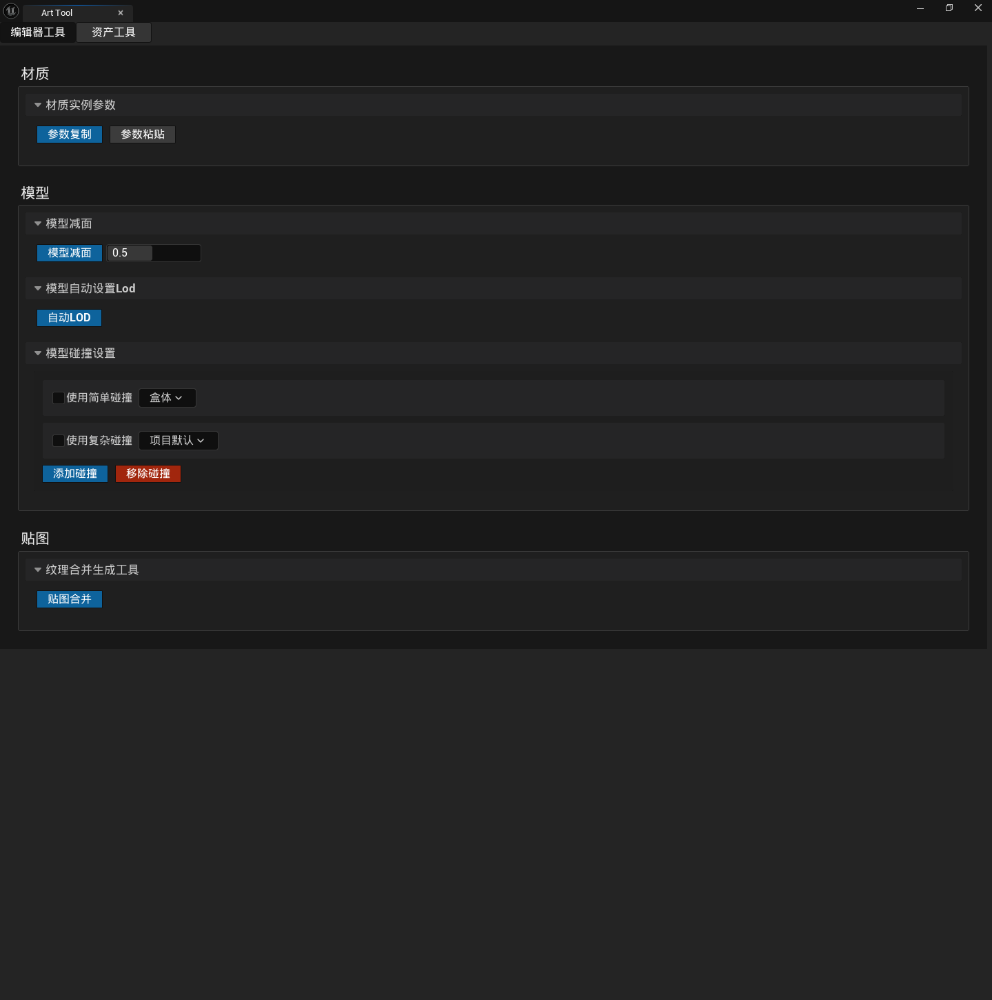

<h1 align="center">ArtTool</h1>

<p align="center">
  面向 Unreal Engine 美术与技术美术工作流的编辑器工具集
</p>

<p align="center">
  <code>版本 1.0</code> &nbsp; <code>Unreal Engine 5.7</code> &nbsp; <code>Editor-only Plugin</code>
</p>

---

ArtTool 基于 Editor Utility Widget、Blueprint 和 Python 启动脚本实现，将常用的场景整理、批量替换、调试视图、模型处理、碰撞设置和资产检查整合到一个可停靠的编辑器面板中。插件不包含 C++ Source 模块，主要逻辑由 Editor Utility Widget、Blueprint 和 Python 启动脚本组成。

> [!IMPORTANT]
> 本插件仅用于 Unreal Editor。删除空 Actor、移除碰撞、模型减面等操作会修改关卡或资产；执行批量操作前请保存关卡并确认已接入版本控制。

## 界面预览

<p align="center">
  
</p>

<p align="center">
  
</p>

## 目录

- [快速开始](#快速开始)
- [功能概览](#功能概览)
- [打开工具](#打开工具)
- [推荐工作流](#推荐工作流)
- [依赖与配置](#依赖与配置)
- [已知限制](#已知限制)
- [故障排查](#故障排查)
- [目录结构](#目录结构)
- [开发说明](#开发说明)

## 快速开始

### 1. 安装插件

将仓库中的 `ArtTool` 目录复制到目标 Unreal 项目：

```text
<YourProject>/Plugins/ArtTool
```

> 仓库根目录中的 `ArtTool/` 即插件根目录。文档中 `Plugins/ArtTool/` 表示它安装到目标工程后的路径。

### 2. 启用依赖

在目标工程中启用以下插件：

| 插件 | 是否必需 | 用途 |
| --- | :---: | --- |
| Editor Scripting Utilities | 是 | 编辑器 Actor、资产和工具脚本操作 |
| Geometry Scripting | 是 | 静态网格体和几何处理 |
| Dataprep Editor | 是 | 数据准备与导入工作流 |
| Scriptable Tools Editor Mode | 是 | 可脚本化编辑器工具支持 |
| Python Editor Script Plugin | 是 | 注册工具栏入口 |
| Modeling Tools Editor Mode | 按需 | 部分模型编辑工作流 |

### 3. 注册工具栏入口

在目标工程的 Python 插件配置中添加启动脚本：

```ini
[/Script/PythonScriptPlugin.PythonScriptPluginSettings]
+StartupScripts=addWidget_plugins.py
```

配置完成后重启 Unreal Editor。启动脚本会在 `LevelEditor.LevelEditorToolBar.User` 注册工具栏按钮。

---

## 打开工具

优先使用工具栏中提示文本为“美术工具”的按钮。若按钮未出现，可在 Content Browser 中启用 `Show Plugin Content`，然后右键运行：

```text
/ArtTool/Art_Tool
```

## 功能概览

| 模块 | 核心能力 |
| --- | --- |
| 场景 Actor | 材质与模型批量替换及回退、自动分配光照贴图分辨率、空 Actor 清理、距离测量 |
| Debug | 材质 Debug、色彩校准、UV Overlay、饱和度、Lumen Reflections、Specular Range |
| 资产工具 | 材质实例参数复制与粘贴、模型减面、自动 LOD、简单与复杂碰撞、贴图合并 |

### 工具界面

主入口资产：

```text
/ArtTool/Art_Tool
```

`Art_Tool` 通过 Widget Switcher 承载两个工具页面，两个页面均支持停靠窗口缩放和独立垂直滚动。

| 页签 | Widget | 用途 |
| --- | --- | --- |
| 编辑器工具 | `WBP_nSpaceDevTool` | 场景 Actor、调试视图和通用编辑器操作 |
| 资产工具 | `WBP_nSpaceDevTool_2` | 材质实例、模型、碰撞、贴图和资产检查 |

### 场景 Actor

| 功能 | 说明 |
| --- | --- |
| 材质替换 | 批量查找指定材质，并按原材质槽位替换为目标材质 |
| 材质回退 | 将匹配的目标材质恢复为替换前材质 |
| 模型替换 | 批量替换 Static Mesh Actor 使用的静态网格体 |
| 模型回退 | 将匹配的目标网格体恢复为替换前网格体 |
| 光照分辨率 | 为选中的 Static Mesh Actor 设置固定或自适应光照分辨率 |
| 空 Actor 检测 | 统计当前选择中不包含有效静态网格体的 Actor |
| 空 Actor 删除 | 根据确认选项删除当前选择中的空 Actor |
| Datasmith 筛选 | 根据 Datasmith User Data 的键和值过滤当前选择 |
| 距离测量 | 测量最后选择的两个 Actor，并生成端点、箭头和距离文本 |
| 清空测量 | 删除距离测量生成的辅助 Actor |
| 工具实例化 | 注册并打开相关 Editor Utility 工具页签 |

### Debug

| 功能 | 说明 |
| --- | --- |
| 材质 Debug | 启用或关闭材质调试辅助视图 |
| UV 查看 | 为场景静态网格体赋予覆层材质，检测 UV 拉伸情况 |
| Lumen Reflections | 切换 Lumen 反射检查视图 |
| Specular Range | 切换高光范围检查视图 |

当前仅保留基础 ColorCorrection 流程。旧版 LUT 流程使用的 `BP_ColorCorrectionPost_Lut`、LUT 纹理、旧校正材质和参数集合已经移除，不再属于受支持功能。

### 资产工具

| 功能 | 说明 |
| --- | --- |
| 材质实例参数复制 | 读取并暂存材质实例参数 |
| 材质实例参数粘贴 | 将暂存参数应用到目标材质实例 |
| 模型减面 | 按设置比例简化静态网格体 |
| 自动 LOD | 自动生成或设置静态网格体 LOD |
| 简单碰撞 | 配置并生成指定类型的简单碰撞 |
| 复杂碰撞 | 配置复杂碰撞方式 |
| 添加碰撞 | 对目标静态网格体添加碰撞 |
| 移除碰撞 | 移除目标静态网格体的碰撞数据 |
| 贴图合并 | 合并多张贴图，有 RGBA 通道 |

## 依赖与配置

### 插件描述文件

`ArtTool.uplugin` 当前声明以下依赖：

| 插件 | 用途 |
| --- | --- |
| EditorScriptingUtilities | 编辑器 Actor、资产和工具脚本操作 |
| GeometryScripting | 静态网格体和几何处理 |
| DataprepEditor | 数据准备与导入工作流 |
| ScriptableToolsEditorMode | 可脚本化编辑器工具支持 |

### 额外要求

- Python Editor Script Plugin 是工具栏入口的实际必需依赖，但尚未写入 `ArtTool.uplugin` 的依赖列表，需要在目标工程中手动启用。
- 目标工程还需要将 `addWidget_plugins.py` 配置为 Startup Script，详见 [快速开始](#快速开始)。

## 已知限制

- 工具主要针对 Windows 编辑器工作流设计。
- 部分操作仅支持 Static Mesh Actor 或 Static Mesh Component。
- 调试工具会在关卡中生成辅助 Actor；不再使用时应关闭对应模式或执行清理。

## 开发说明

| 项目 | 路径 |
| --- | --- |
| 主工具入口 | `/ArtTool/Art_Tool` |
| 编辑器工具页面 | `/ArtTool/WBP_nSpaceDevTool` |
| 资产工具页面 | `/ArtTool/WBP_nSpaceDevTool_2` |
| 工具栏注册脚本 | `ArtTool/Content/Python/addWidget_plugins.py` |
| 插件版本信息 | `ArtTool/ArtTool.uplugin` |

核心资产为二进制 `.uasset`。修改后请在 Unreal Editor 中完成以下检查：

1. 编译所有相关 Blueprint，确认没有新增编译错误或警告。
2. 验证全部按钮、复选框和输入控件的事件绑定。
3. 在测试关卡中执行非破坏性冒烟测试。
4. 使用版本控制检查被修改的资产列表。
